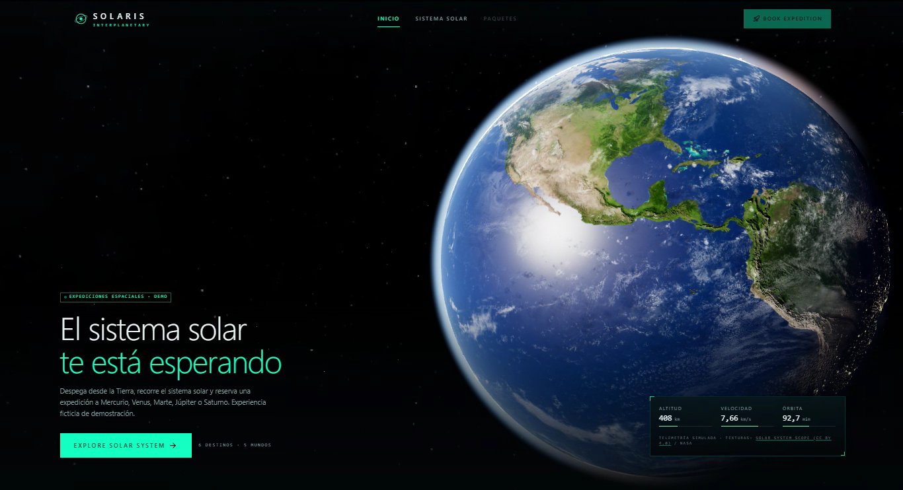

# SOLARIS INTERPLANETARY

> **Live Demo / Ver en vivo / Ver ao vivo:** **[https://solaris.falconit.xyz/](https://solaris.falconit.xyz/)**



**Idiomas / Languages / Idiomas:**
- [🇪🇸 Español](#-español)
- [🇺🇸 English](#-english)
- [🇧🇷 Português (Brasil)](#-português-brasil)

---

# 🇪🇸 Español

## 1. Definición del Proyecto

**SOLARIS INTERPLANETARY** es una experiencia web 3D interactiva y *landing page* comercial ficticia de turismo aeroespacial de lujo. Combina un simulador de exploración del sistema solar en tiempo real sobre **WebGL 2.0** con una interfaz tipo HUD aeroespacial que permite viajar por el sistema solar, inspeccionar planetas y estaciones orbitales en alta resolución (`8K`), consultar telemetría astronómica real y realizar reservas simuladas de expedición.

- **Demo en producción:** [https://solaris.falconit.xyz/](https://solaris.falconit.xyz/)
- **Soporte multilingüe integrado (`i18n`):** selector en tiempo real para **Español (`ES`)**, **Inglés (`EN`)** y **Portugués de Brasil (`PT`)**.

## 2. Cómo Funciona

1. **Inicio orbital sobre la Tierra (`earth_hero`):** la experiencia arranca frente a una Tierra hiperrealista con relieve topográfico, reflejo especular oceánico, luces nocturnas en el lado oscuro, capa de nubes independiente con sombras proyectadas y dispersión atmosférica Rayleigh.
2. **Despliegue de carta estelar (`solar_system`):** al pulsar `EXPLORE SOLAR SYSTEM`, un *timeline* cinematográfico de **GSAP** aleja la cámara con trayectoria curva suave hasta revelar el Sol (con fotosfera convectiva animada y corona volumétrica), el cinturón de asteroides instanciado y las 6 órbitas planetarias.
3. **Selección interactiva 3D y HUD:** inspirado en videojuegos de estrategia espacial como *Star Wars: Empire at War*, el visitante puede seleccionar cualquier planeta haciendo clic directamente sobre su retícula orbital 3D o desde la barra inferior del HUD.
4. **Travelling cinematográfico con evasión solar (`transitioning`):** la cámara interpola posición y punto de mira (`lookAt`) siguiendo una curva 3D que evita automáticamente atravesar el Sol o su corona y bloquea selecciones simultáneas durante el vuelo.
5. **Estabilización en destino y estaciones `.glb` (`planet_detail` / `station_detail`):** al llegar a cada uno de los **6 destinos**, la escena muestra en primer plano su estación orbital 3D (`.glb` glTF 2.0 con anillos centrífugos rotatorios e iluminación PBR), lunas acompañantes (**Europa** en Júpiter y **Titán** en Saturno) o colonias de superficie (biodomos en Marte y Mercurio).
6. **Catálogo comercial, comparador y reserva simulada:** el panel derecho presenta los 3 paquetes exclusivos del destino (`Explorer`, `Voyager`, `Infinity`), un comparador lado a lado y un flujo de reserva demostrativa que emite un pase de embarque interplanetario simulado (`SLR-...`).

### Los 6 Destinos y sus Instalaciones 3D

| Destino | Cuerpo | Instalación 3D (`.glb`) y entorno |
|---|---|---|
| **Mercury — Solar Frontier** | Mercurio | *Helios Shield Relay* (escudo térmico multicapa orientado al Sol) + domos en cráteres del terminador |
| **Venus — Cloud Haven** | Venus | *Cloud Haven Aerostat Complex* sobre la cubierta nubosa de ácido sulfúrico en super-rotación |
| **Mars — Red Frontier** | Marte | *Ares Orbital Transfer Hub* con anillo centrífugo + red de biodomos en Valles Marineris |
| **Jupiter — Europa Orbital Station** | Júpiter | *Galileo Deep-Space Station* en órbita exterior junto a la luna helada **Europa** y la Gran Mancha Roja |
| **Saturn — Titan Orbital Station** | Saturno | *Huygens Orbital Sanctuary* en órbita exterior con vistas a la luna **Titán** y su bruma azul |
| **Saturn — Ring Observation** | Saturno | *Cassini Division Conservatory* suspendido sobre el plano de los anillos A/B y la División de Cassini |

## 3. Tecnologías Utilizadas

| Tecnología | Uso en el proyecto |
|---|---|
| **React 19** | Arquitectura de componentes UI/HUD, `Suspense` y hooks reactivos |
| **TypeScript (Strict)** | Tipado estático estricto en modelos de datos, stores y motor 3D |
| **Vite 8** | Servidor de desarrollo y empaquetado de producción con particionado de *chunks* |
| **Three.js (r187)** | Motor gráfico WebGL 2.0, geometrías, luces PBR, `InstancedMesh` y `ShaderMaterial` |
| **React Three Fiber 9 & Drei** | Grafo de escena declarativo desacoplado de la capa HTML |
| **GLSL Custom Shaders** | Shaders físicos a medida para la Tierra, atmósfera Rayleigh, regolito Lommel-Seeliger (Mercurio), super-rotación (Venus), polvo/hielo polar (Marte), gigantes gaseosos con sombras cruzadas planeta-anillos (Saturno), fotosfera/corona solar y lunas (Europa y Titán) |
| **GSAP** | Timelines cinematográficos de cámara con curvas espaciales y evasión solar |
| **Zustand** | Máquina de estados global de navegación (`navigation.store.ts`), calidad (`quality.ts`) e interfaz/idioma (`ui.store.ts`) |
| **Tailwind CSS 4** | Sistema de diseño HUD aeroespacial responsive |
| **Lucide React** | Iconografía técnica e indicadores de telemetría |
| **Sharp (Build Pipeline)** | Conversión automatizada de mapas planetarios a niveles progresivos `2k / 4k / 8k` en formato WebP |

## 4. Optimización WebGL y Rendimiento

- **Carga progresiva de texturas y presupuesto de VRAM (`useProgressiveTextureSet`):** todos los planetas cargan inicialmente en `2k` (~3,16 MB en total) y únicamente el planeta en primer plano sube sus texturas a `8k`/`4k`, liberando la memoria GPU (`dispose()`) al cambiar de destino.
- **LOD geométrico por foco (`useBodyLod`):** los planetas distantes reducen su malla en un 91 % de triángulos frente al planeta enfocado.
- **Adaptive DPR y degradación dinámica (`AdaptivePerformance`):** ajusta la resolución de renderizado y el perfil de calidad (`ultra → high → medium → low`) midiendo los FPS reales.
- **Fallback 2.5D sin WebGL (`WebGLFallback`):** si WebGL no está disponible o se pierde el contexto GPU, mantiene toda la experiencia comercial y de navegación operativa en 2.5D.

## 5. Ejecución Local y Scripts

```bash
npm install          # Instalar dependencias
npm run dev          # Iniciar servidor de desarrollo en http://localhost:5173
npm run textures     # Generar niveles 2k / 4k / 8k WebP desde assets-src/
npm run models       # Generar los 6 modelos binarios .glb en public/models/
npm run qa           # Ejecutar auditoría automatizada de assets, SEO y configuración
npm run build        # Typecheck estricto + compilación de producción en dist/
npm run lint         # Verificar código con ESLint
```

**Parámetros de URL opcionales:**
- `?lang=es|en|pt` — selecciona el idioma inicial.
- `?quality=low|medium|high|ultra` — fuerza un perfil gráfico.
- `?debug` — muestra monitor en tiempo real de FPS, draw calls, triángulos y VRAM estimada.
- `?nowebgl` — prueba el modo de respaldo 2.5D sin WebGL.

**Documentación técnica adicional:**
- [Plan Maestro de Ingeniería](./SOLARIS_ENGINEERING_PLAN.md)
- [Registro de Assets y Licencias (CC BY 4.0 / CC0)](./docs/ASSETS.md)
- [Auditoría de Rendimiento WebGL](./docs/PERFORMANCE.md)
- [Reporte de QA Final](./docs/QA_REPORT.md)

---

# 🇺🇸 English

## 1. Project Overview

**SOLARIS INTERPLANETARY** is an interactive 3D web experience and fictional luxury space-tourism landing page. It combines a real-time **WebGL 2.0** solar system exploration simulator with an aerospace HUD interface that lets visitors travel across the solar system, inspect planets and orbital stations in up to `8K` resolution, consult real astronomical telemetry, and complete simulated expedition bookings.

- **Live Production Demo:** [https://solaris.falconit.xyz/](https://solaris.falconit.xyz/)
- **Built-in Multilingual Support (`i18n`):** real-time language switcher for **Spanish (`ES`)**, **English (`EN`)**, and **Brazilian Portuguese (`PT`)**.

## 2. How It Works

1. **Earth Orbital Hero (`earth_hero`):** the experience opens in low Earth orbit facing a photorealistic Earth featuring topographic normal relief, ocean specular sun glint, dark-side city lights, an independent animated cloud layer casting surface shadows, and analytic Rayleigh atmospheric scattering.
2. **Star Chart Reveal (`solar_system`):** clicking `EXPLORE SOLAR SYSTEM` triggers a **GSAP** timeline that pulls the camera back along a smooth arc to reveal the Sun (with animated convective granulation and volumetric corona), the instanced asteroid belt, and all 6 planetary orbits.
3. **Interactive 3D & HUD Selection:** inspired by space strategy games like *Star Wars: Empire at War*, users can select any world either by clicking directly on its 3D orbital reticle in space or from the bottom HUD bar.
4. **Cinematic Camera Flight with Solar Avoidance (`transitioning`):** the camera interpolates both position and `lookAt` target along a curved 3D trajectory that automatically steers around the Sun and locks concurrent selections while in flight.
5. **Orbital Arrival & `.glb` Stations (`planet_detail` / `station_detail`):** arriving at any of the **6 destinations** frames its dedicated 3D orbital station (binary glTF 2.0 `.glb` with rotating centrifuge rings and local PBR lighting), companion moons (**Europa** at Jupiter and **Titan** at Saturn), or surface colonies (biodomes on Mars and Mercury).
6. **Commercial Catalog, Comparator & Simulated Booking:** the right-hand HUD panel displays the 3 destination-specific expedition packages (`Explorer`, `Voyager`, `Infinity`), a 3-column tier comparator, and a simulated booking flow that issues a demo interplanetary boarding pass (`SLR-...`).

### The 6 Destinations & 3D Facilities

| Destination | Celestial Body | 3D Facility (`.glb`) & Environment |
|---|---|---|
| **Mercury — Solar Frontier** | Mercury | *Helios Shield Relay* (Sun-tracking multi-layer gold heatshield) + terminator crater domes |
| **Venus — Cloud Haven** | Venus | *Cloud Haven Aerostat Complex* above the super-rotating sulfuric-acid cloud deck |
| **Mars — Red Frontier** | Mars | *Ares Orbital Transfer Hub* with rotating centrifuge ring + Valles Marineris biodomes |
| **Jupiter — Europa Orbital Station** | Jupiter | *Galileo Deep-Space Station* in outer orbit alongside icy moon **Europa** and the Great Red Spot |
| **Saturn — Titan Orbital Station** | Saturn | *Huygens Orbital Sanctuary* in outer orbit overlooking **Titan** and its blue stratospheric haze |
| **Saturn — Ring Observation** | Saturn | *Cassini Division Conservatory* hovering above the A/B ring plane and the Cassini Division |

## 3. Tech Stack

| Technology | Role in Project |
|---|---|
| **React 19** | UI/HUD component architecture, `Suspense`, and reactive hooks |
| **TypeScript (Strict)** | Strict static typing across data models, stores, and 3D engine |
| **Vite 8** | Dev server and production bundler with custom vendor chunk splitting |
| **Three.js (r187)** | WebGL 2.0 rendering engine, geometries, PBR lights, `InstancedMesh`, and `ShaderMaterial` |
| **React Three Fiber 9 & Drei** | Declarative 3D scene graph decoupled from the HTML UI layer |
| **Custom GLSL Shaders** | Bespoke physical shaders for Earth, Rayleigh atmosphere, Lommel-Seeliger regolith (Mercury), cloud super-rotation (Venus), dust & polar ice (Mars), gas giants with mutual planet-ring shadows (Saturn), solar photosphere/corona, and moons (Europa & Titan) |
| **GSAP** | Cinematic camera timelines with curved paths and solar avoidance |
| **Zustand** | Global state machine for navigation (`navigation.store.ts`), quality (`quality.ts`), and UI/locale (`ui.store.ts`) |
| **Tailwind CSS 4** | Responsive aerospace HUD styling system |
| **Lucide React** | Technical iconography and telemetry readouts |
| **Sharp (Build Pipeline)** | Automated conversion of source planetary maps into `2k / 4k / 8k` progressive WebP tiers |

## 4. WebGL Optimization & Performance

- **Progressive Texture Streaming & VRAM Budgeting (`useProgressiveTextureSet`):** all bodies initially load lightweight `2k` textures (~3.16 MB total), while only the focused foreground planet upgrades to `8k`/`4k` and disposes high-res GPU textures upon departure.
- **Distance/Focus Geometry LOD (`useBodyLod`):** distant planets reduce triangle counts by 91% compared to the focused planet.
- **Adaptive DPR & Dynamic Quality Downgrade (`AdaptivePerformance`):** adjusts pixel ratio and quality presets (`ultra → high → medium → low`) based on measured real-time FPS.
- **2.5D WebGL Fallback (`WebGLFallback`):** if WebGL is unavailable or the GPU context is lost, the app seamlessly degrades to an interactive 2.5D view while keeping all navigation and booking features working.

## 5. Local Development & Scripts

```bash
npm install          # Install dependencies
npm run dev          # Start development server at http://localhost:5173
npm run textures     # Generate 2k / 4k / 8k WebP tiers from assets-src/
npm run models       # Generate the 6 binary .glb models in public/models/
npm run qa           # Run automated QA audit on assets, SEO, and config
npm run build        # Strict typecheck + production build into dist/
npm run lint         # Run ESLint verification
```

**Optional URL Parameters:**
- `?lang=es|en|pt` — sets the initial UI language.
- `?quality=low|medium|high|ultra` — forces a graphics quality preset.
- `?debug` — displays the real-time FPS, draw call, triangle, and estimated VRAM overlay.
- `?nowebgl` — tests the 2.5D compatibility fallback mode.

---

# 🇧🇷 Português (Brasil)

## 1. Definição do Projeto

**SOLARIS INTERPLANETARY** é uma experiência web 3D interativa e *landing page* comercial fictícia de turismo aeroespacial de luxo. Combina um simulador de exploração do sistema solar em tempo real em **WebGL 2.0** com uma interface HUD aeroespacial que permite viajar pelo sistema solar, inspecionar planetas e estações orbitais em resolução de até `8K`, consultar telemetria astronômica real e realizar reservas simuladas de expedição.

- **Demo ao vivo em produção:** [https://solaris.falconit.xyz/](https://solaris.falconit.xyz/)
- **Suporte multilíngue integrado (`i18n`):** seletor em tempo real para **Espanhol (`ES`)**, **Inglês (`EN`)** e **Português do Brasil (`PT`)**.

## 2. Como Funciona

1. **Início orbital sobre a Terra (`earth_hero`):** a experiência começa em frente a uma Terra hiper-realista com relevo topográfico, reflexo especular oceânico, luzes noturnas no lado escuro, camada de nuvens independente proyectando sombras e dispersão atmosférica Rayleigh.
2. **Abertura da carta estelar (`solar_system`):** ao clicar em `EXPLORE SOLAR SYSTEM`, uma *timeline* cinematográfica do **GSAP** afasta a câmera em uma trajetória curva suave até revelar o Sol (com fotosfera convectiva animada e coroa volumétrica), o cinturão de asteroides instanciado e as 6 órbitas planetárias.
3. **Seleção interativa 3D e HUD:** inspirado em jogos de estratégia espacial como *Star Wars: Empire at War*, o visitante pode selecionar qualquer planeta clicando diretamente em sua retícula orbital 3D ou na barra inferior do HUD.
4. **Deslocamento cinematográfico com desvio solar (`transitioning`):** a câmera interpola posição e ponto de mira (`lookAt`) seguindo uma curva 3D que evita automaticamente atravessar o Sol ou sua coroa e bloqueia seleções simultâneas durante o voo.
5. **Estabilização no destino e estações `.glb` (`planet_detail` / `station_detail`):** ao chegar a cada um dos **6 destinos**, a cena exibe em primeiro plano sua estação orbital 3D (`.glb` glTF 2.0 com anéis centrífugos rotatórios e iluminação PBR), luas acompanhantes (**Europa** em Júpiter e **Titã** em Saturno) ou colônias de superfície (biodomos em Marte e Mercúrio).
6. **Catálogo comercial, comparador e reserva simulada:** o painel direito apresenta os 3 pacotes exclusivos do destino (`Explorer`, `Voyager`, `Infinity`), um comparador lado a lado e um fluxo de reserva demonstrativa que emite um cartão de embarque interplanetário simulado (`SLR-...`).

### Os 6 Destinos e suas Instalações 3D

| Destino | Corpo Celeste | Instalação 3D (`.glb`) e Ambiente |
|---|---|---|
| **Mercury — Solar Frontier** | Mercúrio | *Helios Shield Relay* (escudo térmico multicamadas voltado para o Sol) + domos em crateras do terminador |
| **Venus — Cloud Haven** | Vênus | *Cloud Haven Aerostat Complex* sobre o manto de nuvens de ácido sulfúrico em super-rotação |
| **Mars — Red Frontier** | Marte | *Ares Orbital Transfer Hub* com anel centrífugo + rede de biodomos em Valles Marineris |
| **Jupiter — Europa Orbital Station** | Júpiter | *Galileo Deep-Space Station* em órbita externa junto à lua gelada **Europa** e à Grande Mancha Vermelha |
| **Saturn — Titan Orbital Station** | Saturno | *Huygens Orbital Sanctuary* em órbita externa com vista para a lua **Titã** e sua névoa azul |
| **Saturn — Ring Observation** | Saturno | *Cassini Division Conservatory* suspenso sobre o plano dos anéis A/B e a Divisão de Cassini |

## 3. Tecnologias Utilizadas

| Tecnologia | Função no Projeto |
|---|---|
| **React 19** | Arquitetura de componentes UI/HUD, `Suspense` e hooks reativos |
| **TypeScript (Strict)** | Tipagem estática estrita nos modelos de dados, stores e motor 3D |
| **Vite 8** | Servidor de desenvolvimento e bundler de produção com divisão de *chunks* |
| **Three.js (r187)** | Motor gráfico WebGL 2.0, geometrias, luzes PBR, `InstancedMesh` e `ShaderMaterial` |
| **React Three Fiber 9 & Drei** | Grafo de cena declarativo desacoplado da camada HTML |
| **GLSL Custom Shaders** | Shaders físicos sob medida para a Terra, atmosfera Rayleigh, regolito Lommel-Seeliger (Mercúrio), super-rotação (Vênus), poeira e gelo polar (Marte), gigantes gasosos com sombras mútuas planeta-anéis (Saturno), fotosfera/coroa solar e luas (Europa e Titã) |
| **GSAP** | Timelines cinematográficos de câmera com curvas espaciais e desvio solar |
| **Zustand** | Máquina de estados global de navegação (`navigation.store.ts`), qualidade (`quality.ts`) e interface/idioma (`ui.store.ts`) |
| **Tailwind CSS 4** | Sistema de estilos HUD aeroespacial responsivo |
| **Lucide React** | Iconografia técnica e indicadores de telemetria |
| **Sharp (Build Pipeline)** | Conversão automatizada de mapas planetários em níveis progressivos `2k / 4k / 8k` WebP |

## 4. Otimização WebGL e Desempenho

- **Carregamento progressivo de texturas e orçamento de VRAM (`useProgressiveTextureSet`):** todos os planetas carregam inicialmente em `2k` (~3,16 MB no total) e apenas o planeta em primeiro plano eleva suas texturas para `8k`/`4k`, liberando a memória GPU (`dispose()`) ao mudar de destino.
- **LOD geométrico por foco (`useBodyLod`):** planetas distantes reduzem sua malha em 91% menos triângulos em comparação ao planeta em foco.
- **Adaptive DPR e degradação dinâmica (`AdaptivePerformance`):** ajusta a resolução de renderização e o perfil de qualidade (`ultra → high → medium → low`) medindo os FPS reais.
- **Fallback 2.5D sem WebGL (`WebGLFallback`):** se o WebGL não estiver disponível ou o contexto GPU for perdido, mantém toda a experiência comercial e de navegação funcional em 2.5D.

## 5. Execução Local e Scripts

```bash
npm install          # Instalar dependências
npm run dev          # Iniciar servidor de desenvolvimento em http://localhost:5173
npm run textures     # Gerar níveis 2k / 4k / 8k WebP a partir de assets-src/
npm run models       # Gerar os 6 modelos binários .glb em public/models/
npm run qa           # Executar auditoria automatizada de assets, SEO e configuração
npm run build        # Typecheck estrito + build de produção em dist/
npm run lint         # Verificar código com ESLint
```

**Parâmetros de URL opcionais:**
- `?lang=es|en|pt` — define o idioma inicial da interface.
- `?quality=low|medium|high|ultra` — força um perfil de qualidade gráfica.
- `?debug` — exibe o monitor em tempo real de FPS, draw calls, triângulos e VRAM estimada.
- `?nowebgl` — testa o modo de contingência 2.5D sem WebGL.
